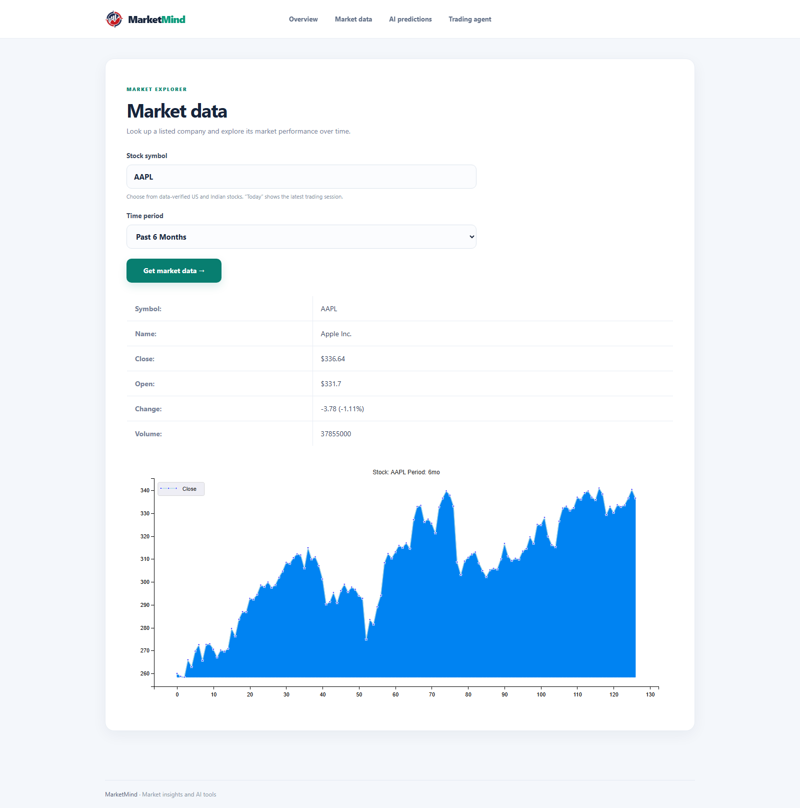
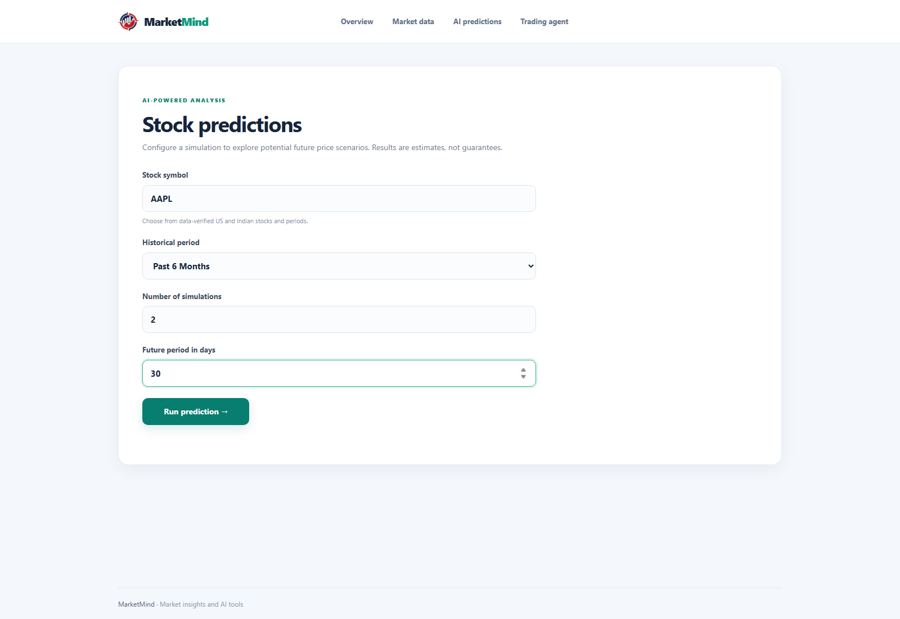
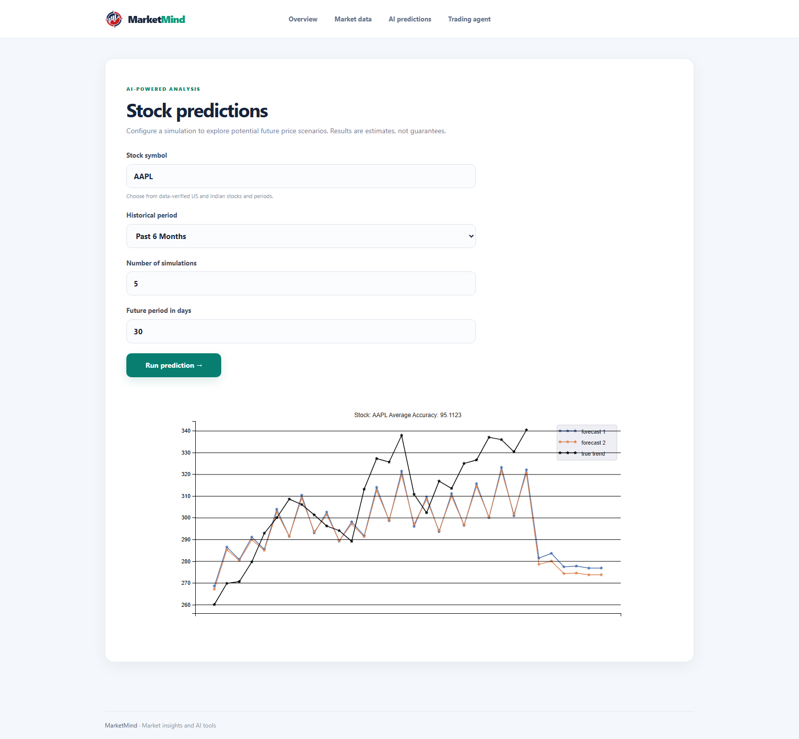
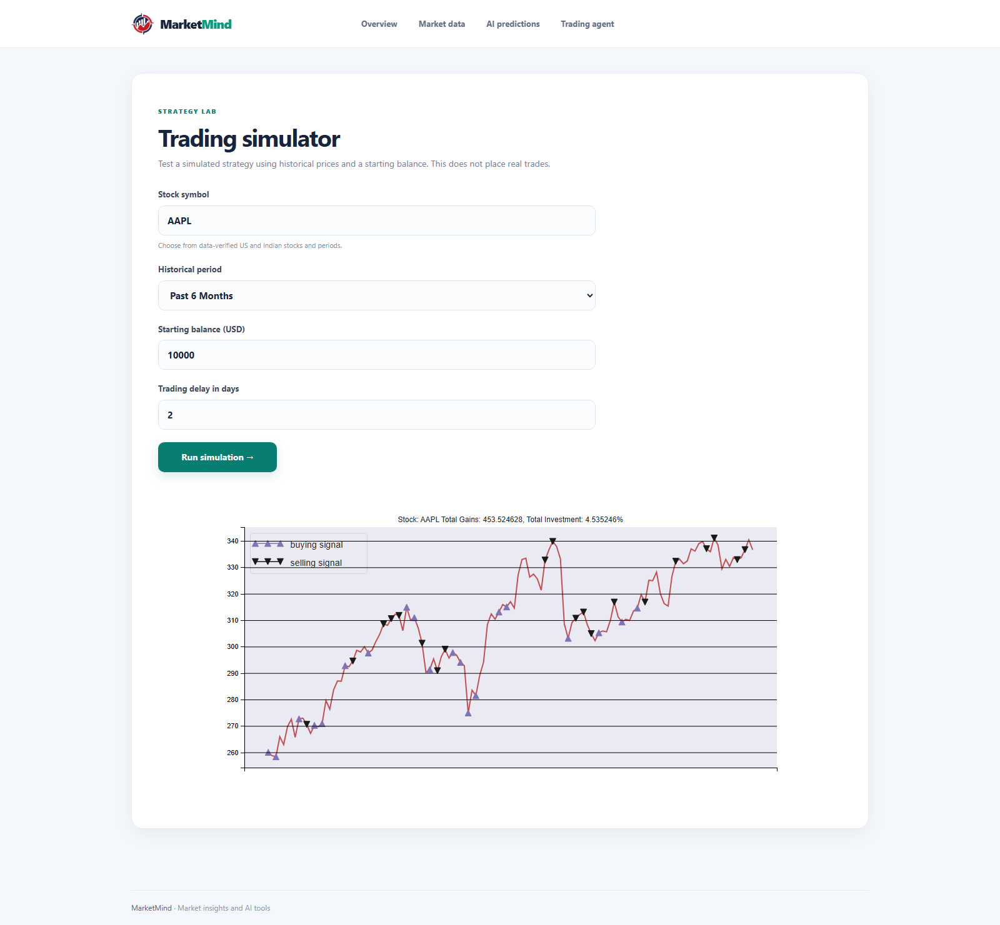

# MarketMind

Explore stock-market history, experiment with possible price paths, and see how
a simulated trading strategy behaves. **MarketMind** is a Django web app for
learning and experimentation; it does not place real trades or provide
investment advice.

## At a glance

| | |
| --- | --- |
| Application | Django web application |
| Market data | Yahoo Finance, through `yfinance` |
| Markets in the symbol list | US and India |
| Forecast methods | LSTM when TensorFlow is available; Monte Carlo fallback otherwise |
| Charting | Matplotlib and `mpld3` |
| Default database | SQLite |
| Live trading | Not supported |

## Screenshots

The screenshots below show the current MarketMind interface and example
results. Form values and chart results are illustrative, captured examples;
market prices depend on the data provider and capture time.

### MarketMind overview

<p align="center">
  
</p>

### Explore historical market data

Choose a listed symbol and time period to view a stock summary and closing-price
chart.

| Choose a symbol and period | Example summary and chart |
| --- | --- |
|  |  |

### Generate experimental price forecasts

Choose a symbol and historical period, then set the number of paths and future
horizon. Forecast charts illustrate model output; they are not guaranteed
predictions or a validated measure of future accuracy.

| Forecast settings | Example forecast chart |
| --- | --- |
|  |  |

### Run a historical trading simulation

Choose a symbol and time period, starting balance, and trading delay. The
simulator plots example buy and sell signals against historical prices; it
does not connect to a broker.

| Simulation settings | Example simulation chart |
| --- | --- |
|  |  |

## What you can do

### Market data

- Search the application's verified ticker list for US and Indian stocks.
- Request a period from one day through maximum available history.
- Review the returned company summary and an interactive closing-price chart.
- Hover over chart points to inspect available date and price details.

### Price forecasts

- Choose a listed ticker and a supported historical period.
- Run between **1 and 10** simulation paths.
- Select a forecast horizon between **30 and 365 days**.
- Use the LSTM implementation when TensorFlow is installed; otherwise, the
  prediction module uses a Monte Carlo simulation based on historical returns.

The fallback and LSTM results are experimental scenarios, not investment
recommendations. The project does not establish predictive performance through
a rigorous out-of-sample evaluation.

### Trading simulator

- Choose a listed ticker and a supported historical period.
- Set a starting balance from **$1 to $100,000**.
- Set a trading delay from **0 to 10 days**.
- View the historical price series with simulated buy/sell signals and summary
  values.

This is a historical strategy experiment. It does not execute orders, include
a brokerage connection, or guarantee that results would repeat.

### Accounts and verification

- Market pages require a signed-in account.
- Registration uses SMS verification through Twilio. The phone number is
  required; email is optional and is not verified during registration.
- Password reset is sent to the account email using SMTP.
- OTPs expire after five minutes. Requests are rate-limited and verification
  attempts are limited.

SMS and email delivery need valid service credentials; without them, codes
cannot be delivered.

## Run locally

### Requirements

- Git
- Python with `pip`
- Network access to retrieve market data
- Twilio credentials for SMS registration
- SMTP credentials if you want to test email-based password reset

The current development setup uses Python 3.12.10 and Django 3.1.13. **Django
3.1 is no longer supported upstream.** This repository is a development
prototype; update and test the framework and dependencies before using it in a
public deployment.

### 1. Clone the project

```bash
git clone https://github.com/gamepatt78/MarketMind.git
cd MarketMind
```

### 2. Create a virtual environment

**Windows PowerShell**

```powershell
py -3.12 -m venv .venv
.\.venv\Scripts\Activate.ps1
python -m pip install --upgrade pip
```

If PowerShell blocks activation for this terminal, run:

```powershell
Set-ExecutionPolicy -Scope Process -ExecutionPolicy RemoteSigned
.\.venv\Scripts\Activate.ps1
```

**macOS / Linux**

```bash
python3 -m venv .venv
source .venv/bin/activate
python -m pip install --upgrade pip
```

### 3. Install the application dependencies

```bash
python -m pip install Django==3.1.13 numpy pandas scikit-learn matplotlib mpld3 seaborn tqdm yfinance requests
```

TensorFlow is optional. Install it to enable the LSTM forecast implementation;
without TensorFlow, the forecast module falls back to Monte Carlo simulations.
TensorFlow installation compatibility depends on the selected Python version
and operating system.

```bash
python -m pip install tensorflow
```

`requirements.txt` is an old environment-specific package snapshot and is not
the recommended installation command for a fresh environment.

### 4. Configure SMS and email delivery

Set service credentials as environment variables in the same environment where
you run Django. Do not commit real credentials or paste them into issues or
chat.

**Required for registration SMS:**

```text
TWILIO_ACCOUNT_SID=your-account-sid
TWILIO_AUTH_TOKEN=your-auth-token
TWILIO_FROM_PHONE=your-twilio-number
```

**Required only for email password reset:**

```text
EMAIL_HOST=smtp.example.com
EMAIL_PORT=587
EMAIL_HOST_USER=your-smtp-username
EMAIL_HOST_PASSWORD=your-smtp-password
EMAIL_USE_TLS=true
DEFAULT_FROM_EMAIL=your-verified-sender@example.com
```

For example, in PowerShell you can set values for the current terminal session:

```powershell
$env:TWILIO_ACCOUNT_SID = "your-account-sid"
$env:TWILIO_AUTH_TOKEN = "your-auth-token"
$env:TWILIO_FROM_PHONE = "+15551234567"
```

Use your real Twilio-issued values locally; the example above is not a working
credential.

### 5. Create the database and start the server

```bash
python manage.py migrate
python manage.py runserver 127.0.0.1:8000
```

Visit <http://127.0.0.1:8000/>. Register using a phone number that can receive
SMS, verify the code, and then sign in.

## Supported symbols and periods

The ticker list is maintained in
[`Stock/backend/stockinfo.py`](Stock/backend/stockinfo.py).

| Market | Symbols |
| --- | --- |
| United States | `AAPL`, `MSFT`, `NVDA`, `GOOGL`, `AMZN`, `META`, `TSLA`, `JPM` |
| India | `RELIANCE.NS`, `TCS.NS`, `HDFCBANK.NS`, `INFY.NS`, `ICICIBANK.NS`, `SBIN.NS`, `BHARTIARTL.NS`, `ITC.NS` |

Available periods are `1d`, `5d`, `1mo`, `6mo`, `1y`, `5y`, and `max`. Data
availability depends on Yahoo Finance and the selected symbol/period.

## How it is structured

1. A Django view validates the requested symbol, period, and form values.
2. Backend modules retrieve price history from Yahoo Finance with `yfinance`.
3. The prediction or simulation module processes the historical series and
   builds a chart.
4. Django renders the result in the browser with interactive chart output.

## Project layout

| Path | Responsibility |
| --- | --- |
| `manage.py` | Django management commands |
| `Stock/` | Application views, account logic, tests, templates, and migrations |
| `Stock/backend/stockinfo.py` | Supported symbols, market-data retrieval, and price charts |
| `Stock/backend/predict.py` | LSTM and Monte Carlo forecast paths |
| `Stock/backend/trade.py` | Historical evolution-strategy trading simulation |
| `Stock/templates/` | Login, registration, market, prediction, and simulator pages |
| `Stock/static/` | Application styles and static assets |
| `StockMarket/` | Django project settings and URL configuration |
| `assets/` | README screenshots and model diagrams |

Academic report documents and report folders are intentionally kept out of
this repository.

## Tests and checks

Run the Django configuration check and application tests from the activated
virtual environment:

```bash
python manage.py check
python manage.py test Stock
```

## Security and deployment notes

The checked-in settings are for development: `DEBUG` is enabled, `ALLOWED_HOSTS`
is empty, and the default secret key is explicitly development-only. Before
deployment:

- set a unique, private `DJANGO_SECRET_KEY`;
- disable debug mode and configure allowed hosts, HTTPS, and secure cookies;
- use a production database and WSGI/ASGI server;
- configure Twilio and SMTP credentials outside the repository;
- review Django and third-party dependency versions, update unsupported
  software, and test the changes;
- add deployment-appropriate logging, monitoring, backup, and rate-limit
  controls.

Never commit passwords, API tokens, OTPs, `.env` files, session cookies, or a
local database.

## License

See [`LICENSE`](LICENSE).
